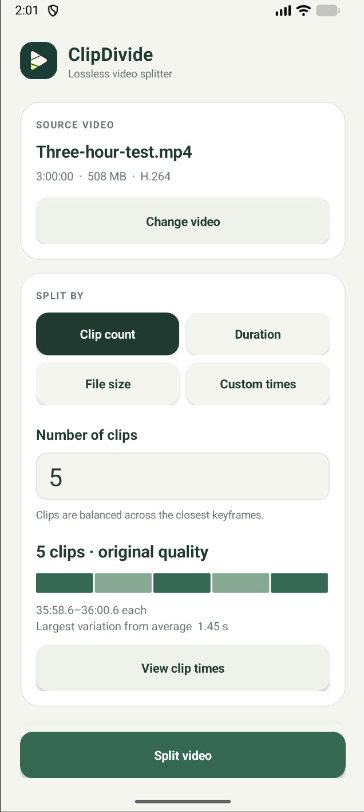
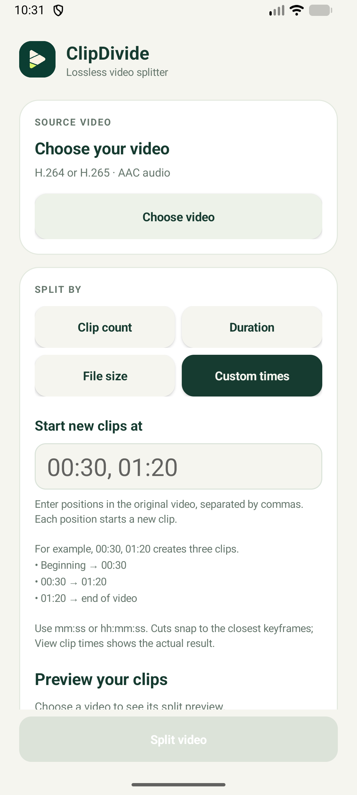
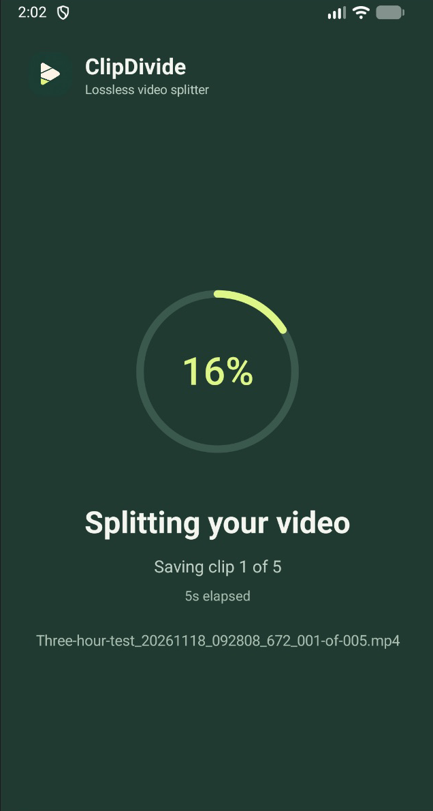
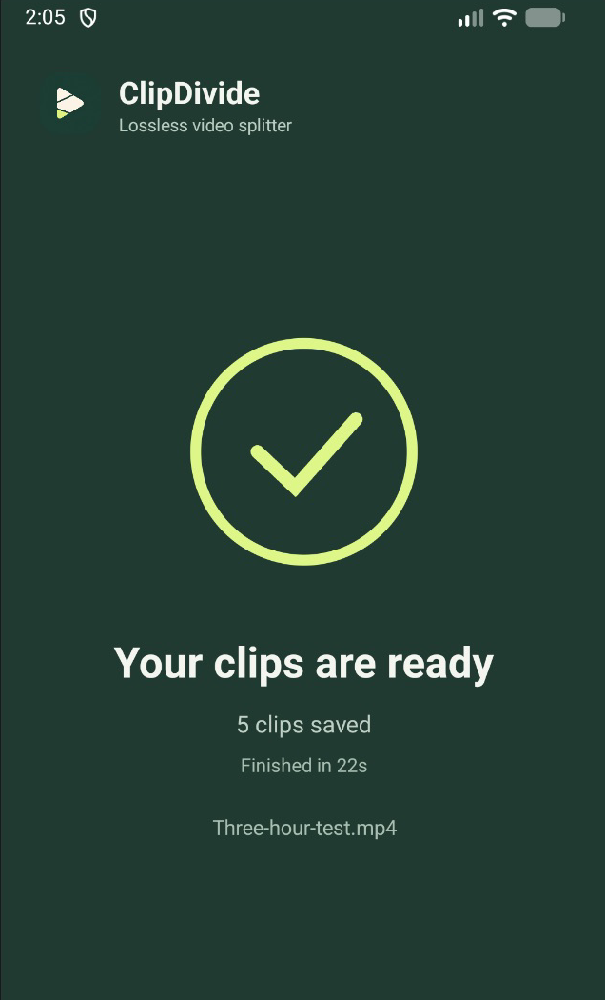
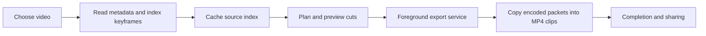

<p align="center">
  
</p>

# ClipDivide · Lossless Android Video Splitter

**Split long videos into separate MP4 clips on Android, without re-encoding.**

ClipDivide is an offline Android video cutter built for a simple workflow. Choose a video, split by clip count, duration, approximate file size or custom timestamps, then save your clips with their original encoded video and audio.

[**Download the Android APK**](https://github.com/abhinand-sabu/clipdivide-android-video-splitter/releases/download/v1.2.0/ClipDivide-v1.2.0.apk) · [Release notes](https://github.com/abhinand-sabu/clipdivide-android-video-splitter/releases/tag/v1.2.0) · [How it works](docs/ARCHITECTURE.md) · [Report an issue](https://github.com/abhinand-sabu/clipdivide-android-video-splitter/issues)


## Screenshots

<p>
  
  
  
  
</p>

Screenshots show the native Android app running in an emulator with generated test media.

## Features

- **Four split modes** for equal clip counts, target durations, approximate file sizes and custom cut positions.
- **Lossless MP4 export** by copying encoded H.264/H.265 video and AAC audio packets.
- **Long-video handling** with streaming file reads and 64-bit timestamps.
- **Balanced keyframe cuts** that reduce the largest clip-length variation in count mode.
- **Preview before export** with expected durations, a segment timeline and detailed cut times.
- **Cached cut-point analysis** so export reuses the import scan.
- **Background export** with a progress notification and cancellation.
- **Persistent completion screen** with a checkmark animation, folder access and clip sharing.
- **Offline processing** with no account, ads, analytics SDK or internet permission.

## Download and install

1. Download `ClipDivide-v1.2.0.apk` from [GitHub Releases](https://github.com/abhinand-sabu/clipdivide-android-video-splitter/releases/tag/v1.2.0).
2. Open the APK on an Android 10 or newer device. Android may ask you to allow installation from the app you used to open it.
3. Launch ClipDivide and choose your source video.

The release includes a SHA-256 checksum file. The published APK is signed, and Android debugging is disabled in that build.

## Choose a split mode

| Mode | Example input | Result |
| --- | --- | --- |
| Clip count | `5` | Five approximately equal-length clips |
| Duration | `60` seconds | Clips near one minute, with the remainder in the last clip |
| File size | `100` MB | An estimated clip count based on source size, with balanced durations |
| Custom times | `00:30, 01:20` | Beginning–00:30, 00:30–01:20, then 01:20–end |

Custom times are positions along the original video. Use seconds, `mm:ss` or `hh:mm:ss`, separated by commas and listed in increasing order. Fractional seconds are supported. The first clip starts at the beginning, and the final clip keeps the remaining video.

Cut positions snap to available keyframes. **The preview shows the actual result.** Sparse keyframes can cause variation above two seconds. Approximate file-size targets also depend on bitrate and MP4 overhead.

## Export your clips

Choose a local output folder with room for approximately another copy of the source. Tap **Split video** to start. You can use other apps while the foreground export service runs.

The source video is retained. Output filenames contain a timestamp and numbered clip positions. Cancellation removes files created by the current job. If Android interrupts the process, a later export attempts cleanup and restarts the job from the beginning.

## Supported media

| Requirement | Current support |
| --- | --- |
| Android | Android 10 / API 29 or newer |
| Video | One H.264/AVC or H.265/HEVC track |
| Audio | Optional AAC audio tracks |
| Output | MP4 |
| Split count | 2–999 clips, subject to available keyframes |
| Storage | Local, seekable file providers |

Unsupported extra tracks produce an explanation. Format support also depends on Android's native media extractor. Multi-gigabyte files and a broader device matrix still need validation.

## Under the hood



`MediaExtractor` supplies encoded samples. `MediaMuxer` writes them into each MP4. The exporter retains one reader per track across clips and reuses a direct byte buffer and packet metadata object. The recording is never loaded into RAM in full.

Count mode evaluates nearby keyframe candidates and uses dynamic programming to reduce the worst clip-length deviation. Export uses the cached source index and the boundaries already previewed in the interface.

Read the [architecture overview](docs/ARCHITECTURE.md) for caching, timestamp handling, B-frames, background execution and interrupted-export cleanup.

## Build from source

Open the repository in Android Studio, or use the included Gradle Wrapper.

The project uses JDK 25 for Gradle, Java 17 source compatibility, Android Gradle Plugin 9.5.1, Gradle 9.6.0, compile SDK 37 and target SDK 36. Install Android SDK platform `android-37.0` and build tools `36.0.0`.

```sh
git clone https://github.com/abhinand-sabu/clipdivide-android-video-splitter.git
cd clipdivide-android-video-splitter
./gradlew :app:testDebugUnitTest :app:lintDebug :app:assembleDebug
```

The development APK is written to `app/build/outputs/apk/debug/app-debug.apk`. An optional GitHub Actions workflow is provided in `docs/ci/android.yml`; copy it to `.github/workflows/android.yml` to enable automated checks and development APK artifacts. Published release APKs use the project's separate signing identity.

For a release package through Gradle, run `./gradlew :app:assembleRelease` and supply your own release signing configuration. The default Gradle release output is unsigned.

### Optional local SDK build

`build-apk.py` uses the installed SDK and JDK directly, without downloading Gradle dependencies. Its defaults match Android Studio on macOS. Override `ANDROID_HOME` and `JAVA_HOME` for your installation.

```sh
python3 build-apk.py --release --output ClipDivide.apk
```

The helper generates a local signing key under `.signing/` when one is absent. Keep that directory private and back it up to retain update compatibility. You can select an existing compatible keystore with `CLIPDIVIDE_KEYSTORE`. Signing files are excluded from Git.

## Validation

- A generated **three-hour, 508 MB H.264/AAC video with B-frames** exported into seven clips in the emulator.
- All **107,773 encoded video packets** matched source hashes and order.
- Exported AAC packets matched except for the source's initial pre-roll packet.
- All seven clip beginnings and endings decoded successfully.
- The optimized export took about **11 seconds** in that emulator. Cached import took about **32 ms**. Performance varies by device, source and storage.
- Across **500 synthetic keyframe layouts**, balancing improved the worst length variation in 249 cases and matched the earlier planner in the rest.
- Planner tests cover long timestamps, all four modes, malformed inputs and cached-plan validation. Cancellation and cache reuse were also checked on the emulator.

## Contributing

Run the unit tests, lint and debug build before submitting a pull request. For media-related issues, include the Android version, video/audio codecs, duration, approximate file size, split mode and the error shown by the app. A small reproducible sample helps diagnose file-specific behavior.

See [the changelog](CHANGELOG.md) for release history.

## License

ClipDivide source and project artwork are provided under the [MIT license](LICENSE). The Gradle Wrapper retains its upstream licensing.
